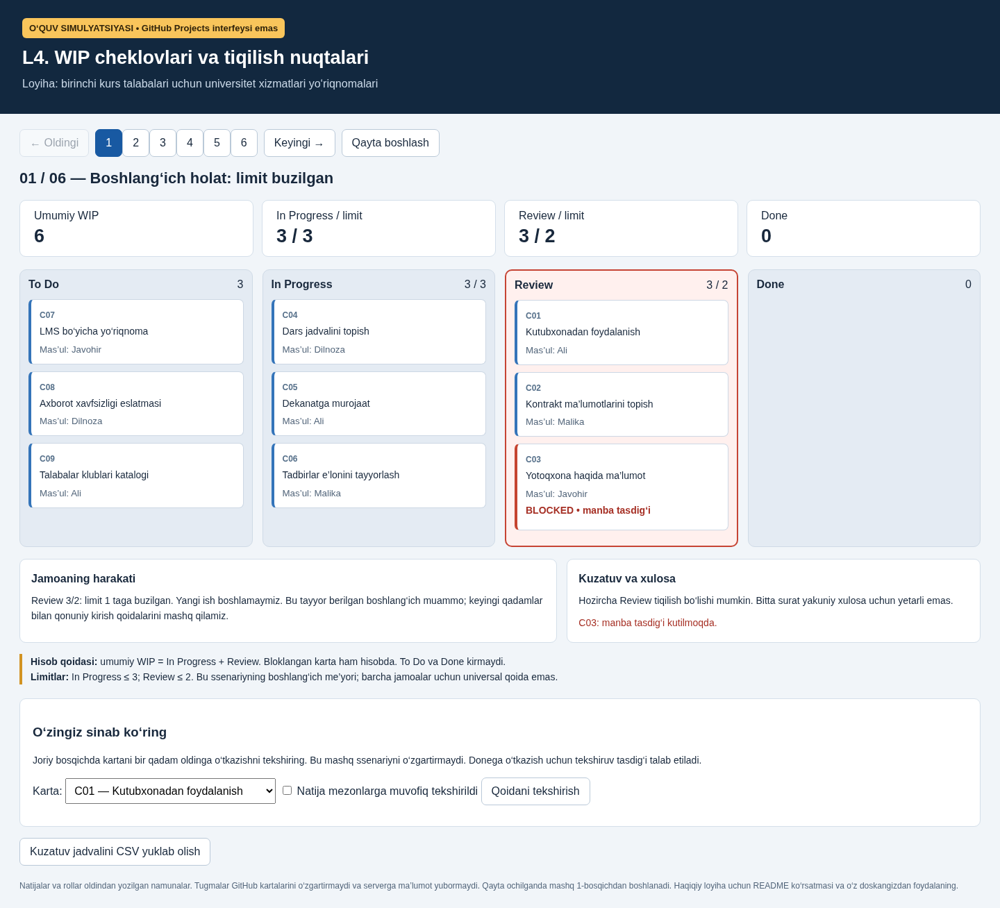
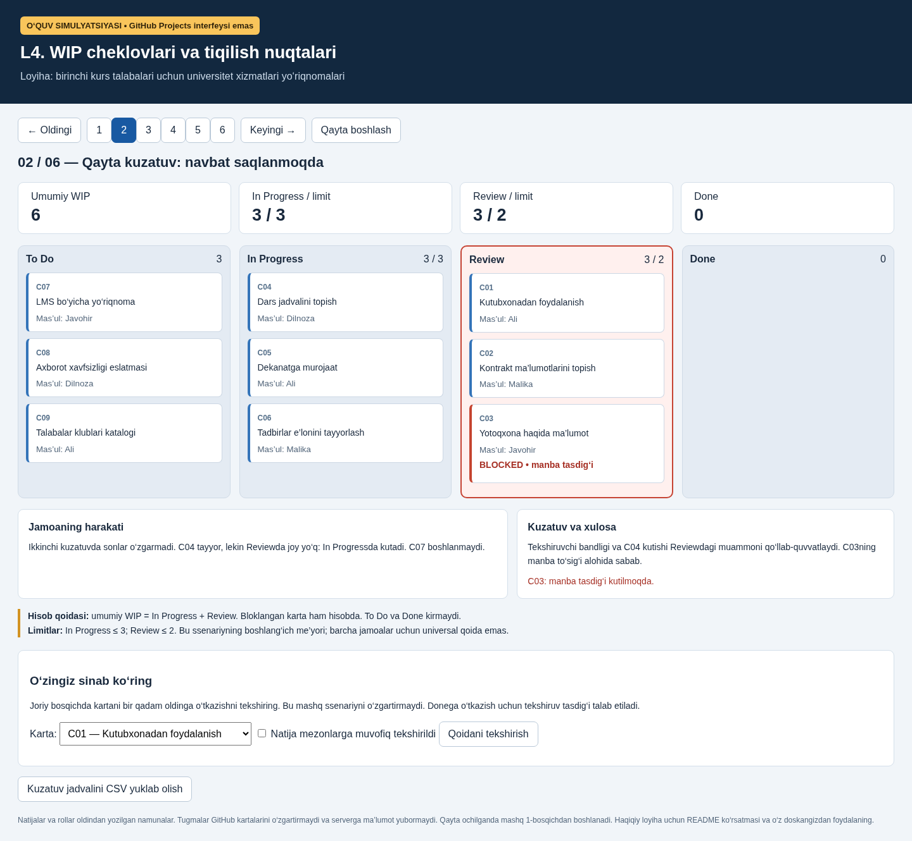
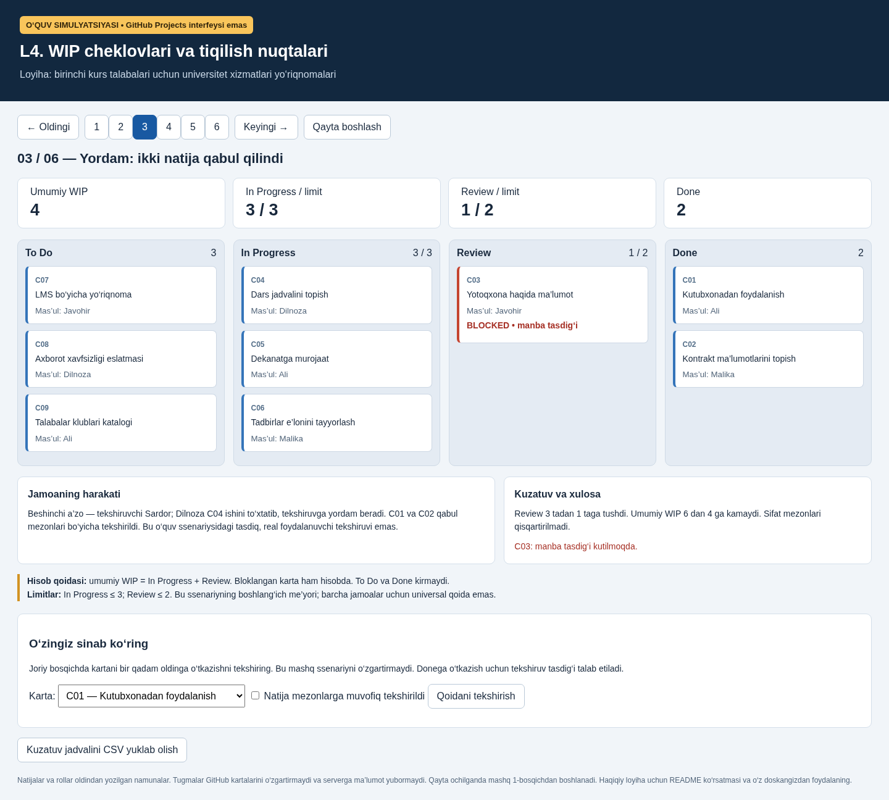
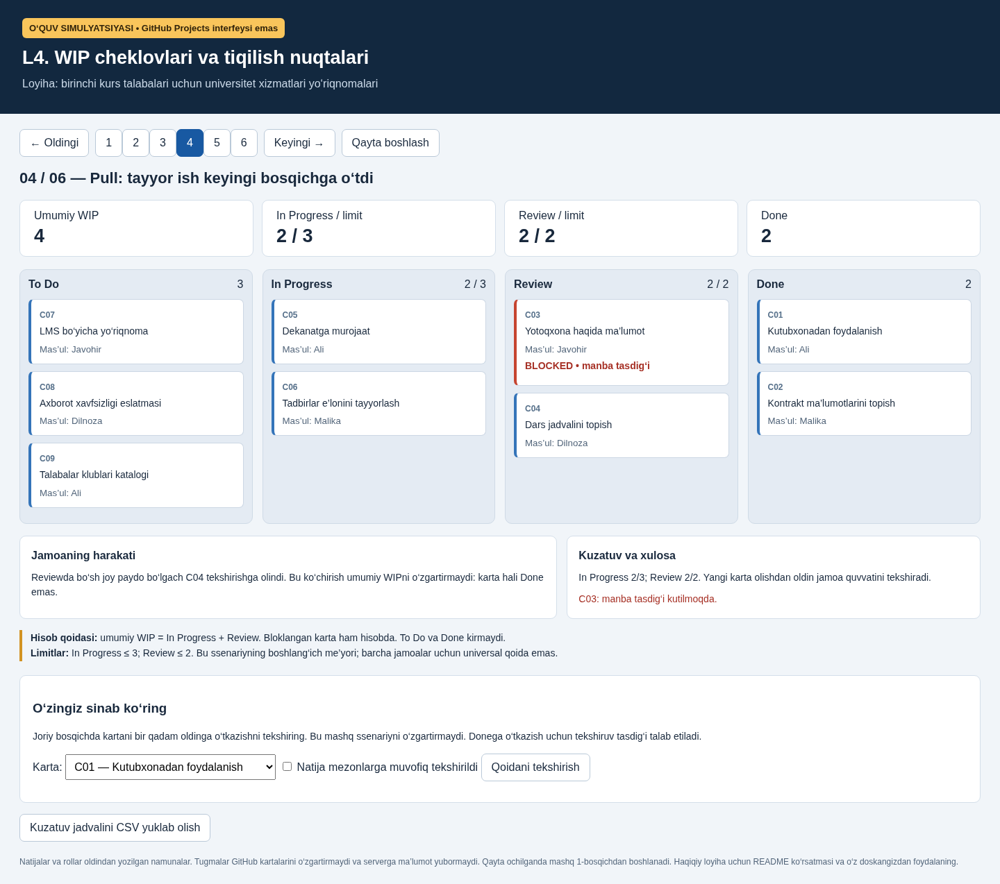
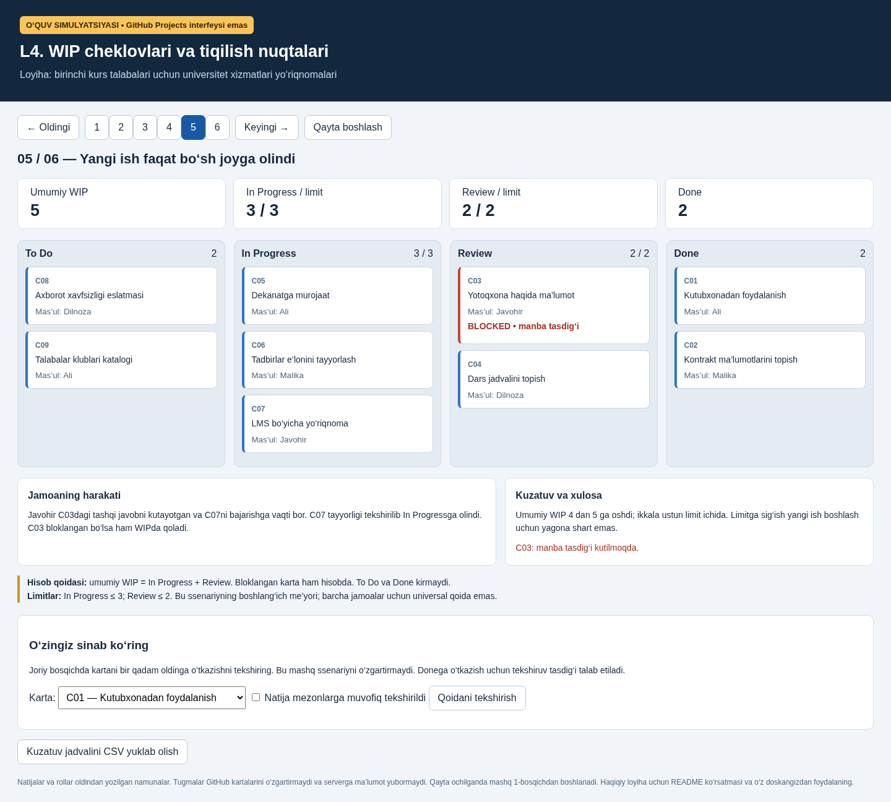
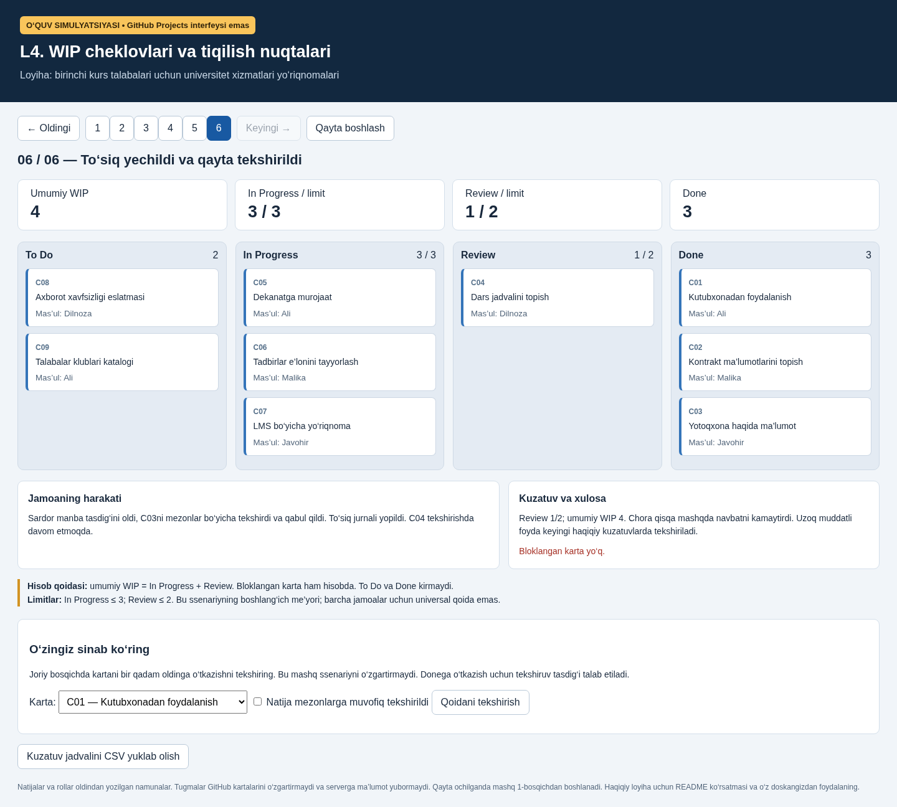

# L4. GitHubda bajariladigan amaliy loyiha

**WIP cheklovlari va tiqilish nuqtalarini aniqlash — rasmlar, ishlaydigan mashq va bosqichlar.**

Bu paket L1–L3 davomi: mavjud jamoa, backlog, To Do → In Progress → Review → Done doskasi va Done mezonlari saqlanadi.

> Rasmlar shu paketdagi ishlaydigan o‘quv simulyatoridan olingan; ular GitHub Projects interfeysining skrinshotlari emas. Jonli Projects doskasi va Issues avtomatik yaratilmagan. Ularni o‘z hisobingizda yaratish tartibi quyida. Namunadagi rollar va tasdiqlar sun’iy o‘quv ma’lumotlari.

## 1. Yuklab olish va namoyish qilish

- [Rasmli Word qo‘llanma](https://github.com/all1991here-dot/prezentatsiyalar/raw/refs/heads/main/LOBM404_UniGuide/Dars_materiallari/L4_rasmli_amaliy_qollanma.docx).
- [Barcha fayllar — ZIP](https://github.com/all1991here-dot/prezentatsiyalar/raw/refs/heads/main/LOBM404_UniGuide/Dars_materiallari/L4_amaliy_loyiha.zip).
- [Interaktiv mashq — index.html](https://github.com/all1991here-dot/prezentatsiyalar/raw/refs/heads/main/LOBM404_UniGuide/L4_amaliy_loyiha/index.html).
- [Avvalgi L4 dars ishlanmasi](../Dars_materiallari/L4_WIP_cheklovlari_va_tiqilish_nuqtalari.docx).

GitHub sahifasida pastdagi 6 rasmni ketma-ket ko‘rsatsangiz ham darsni o‘tish mumkin. Interaktiv mashq uchun index.html faylini yuklab olib brauzerda oching; GitHubning fayl sahifasi HTMLni dastur sifatida ishga tushirmaydi. Agar mahalliy HTML ochilishi cheklangan bo‘lsa, paket papkasida quyidagi buyruq bilan mahalliy server ochiladi (Python 3 kerak):

    python -m http.server 8766 --bind 127.0.0.1

Shu kompyuterdagi 8766-portni brauzerda oching. Mashq mahalliy HTTP orqali Chromiumda tekshirildi. GitHub Pages nashri sozlanmagan.

## 2. Paket tarkibi

| Fayl/papka | Vazifasi |
|---|---|
| index.html | 6 bosqich, WIP hisoblagichlari, qoidani tekshirish va CSV yuklash |
| rasmlar/ | Har bosqichdan bittadan — 6 ta skrinshot |
| ssenariy.json | Kartalar, limitlar va holatlarning ochiq ma’lumotlari |
| kuzatuv_namunasi.csv | To‘ldirilgan o‘quv jadvali |
| kontent/C01.md–C09.md | Haqiqiy jamoa to‘ldiradigan natija shablonlari |
| tayyor_natija_namunasi.md | C01 uchun to‘ldirilgan sun’iy kontent |
| shablonlar/HISOBOT.md | Talaba hisoboti, blok jurnali, individual hissa |
| shablonlar/kuzatuv.csv | Haqiqiy kuzatuvlar uchun bo‘sh jadval |

## 3. Loyiha pasporti

**Nom:** Birinchi kurs talabalari uchun universitet xizmatlari yo‘riqnomalari.

**Muammo:** talaba zarur ma’lumotlarni turli joylardan qidiradi.

**Maqsad:** 9 mavzu bo‘yicha qisqa, manbali va tekshirilgan yo‘riqnoma tayyorlash; jarayonni Kanban asosida boshqarish.

**Natija:** har bir kontentda kamida 3 qadam, tekshiriladigan manba, sana va boshqa a’zo tekshiruvi bo‘ladi.

**Rollar:** Ali, Malika, Javohir, Dilnoza — mualliflar; Sardor — tekshiruvni muvofiqlashtiruvchi. Mualliflar o‘zlari yozmagan materialni tekshirishga yordam beradi. Bular namunaviy ismlar; haqiqiy loyiha uchun jamoa a’zolarini yozing.

Haqiqiy to‘lov yoki login tizimini yaratish shart emas. Tasdiqlanmagan manzil, ish vaqti va narx fakt sifatida berilmaydi.

## 4. GitHubda ish joyini tayyorlash

1. L1–L3 dagi o‘z jamoangiz repozitoriysini oching. Yozish huquqi bo‘lmasa, o‘z hisobingizga Fork qiling yoki o‘zingiz boshqaradigan repo bilan ishlang.
2. Add file → Create new file orqali team/L4/HISOBOT.md yarating. Hisobot shablonini joylang va Commit changes bilan saqlang.
3. Mavjud WORKFLOW.md yoki PROJECT_POLICY.md fayliga quyidagi WIP siyosatini qo‘shing.
4. Projects bo‘limidan mavjud L3 doskasini oching. Yo‘q bo‘lsa, hisobingizdagi Projects → New project orqali Board ko‘rinishidagi loyiha yarating va zarur bo‘lsa repoga bog‘lang.
5. Board kartalari Status bo‘yicha guruhlansin. Status variantlari: To Do, In Progress, Review, Done. Zarur tahrirni loyiha sozlamalaridagi Status maydonida bajaring. Menyu nomlari GitHub tili va interfeysiga qarab farqlanishi mumkin.
6. Loyiha tavsifi yoki readme qismida limitni yozing: In Progress ≤ 3; Review ≤ 2. Avtomatik limit nazorati bor deb hisoblamang; bu darsda jamoa sonni qo‘lda nazorat qiladi.

Repo fayllarini yuklab olishning o‘zi Projects doskasini yaratmaydi. Repo va Project yozish huquqlari alohida bo‘lishi mumkin. Oldingi doska tayyor bo‘lsa, uni qayta yaratmang.

## 5. Kartalarni yaratish

Mavjud backlogdan oling yoki alohida o‘quv simulyatsiyasi doskasida quyidagi 9 kartani yarating. Oldingi 15–20 kartani o‘chirmang. Haqiqiy WIP hisobida barcha boshlangan va tugamagan kartalarni sanang; faqat ushbu 9 kartaga filtr qo‘yib haqiqiy umumiy WIPni yashirmang.

Har bir karta uchun Issues → New issue yoki Project ichida draft item ishlatish mumkin. Issueni Projects maydoni orqali doskaga qo‘shing; bu maydon bo‘lmasa doskadagi Add item orqali mavjud Issueni tanlang.

| ID | Sarlavha | Mas’ul | Boshlang‘ich holat |
|---|---|---|---|
| C01 | Kutubxonadan foydalanish | Ali | Review |
| C02 | Kontrakt ma’lumotlarini topish | Malika | Review |
| C03 | Yotoqxona haqida ma’lumot | Javohir | Review |
| C04 | Dars jadvalini topish | Dilnoza | In Progress |
| C05 | Dekanatga murojaat | Ali | In Progress |
| C06 | Tadbirlar e’lonini tayyorlash | Malika | In Progress |
| C07 | LMS bo‘yicha yo‘riqnoma | Javohir | To Do |
| C08 | Axborot xavfsizligi eslatmasi | Dilnoza | To Do |
| C09 | Talabalar klublari katalogi | Ali | To Do |

Issue raqami (#12 kabi) o‘quv IDsi bilan teng bo‘lishi shart emas. Sarlavha: [C01] Kutubxonadan foydalanish.

Har bir kartaga ehtiyoj, natija fayli, mas’ul, tekshiruvchi, Priority, qabul mezonlari, boshlangan vaqt va blok izohini kiriting. Namunaviy rolni haqiqiy GitHub foydalanuvchisiga tasodifiy biriktirmang; tavsifda yozish yetarli.

**Qabul mezonlari:** kamida 3 aniq qadam; manba va tekshirilgan sana; tasdiqlanmagan ma’lumot fakt sifatida yozilmagan; shaxsiy ma’lumot yo‘q; boshqa a’zo tekshirgan; natijaga havola mavjud. [Kontent shablonlari](kontent/) tayyor.

## 6. Tayyor WIP siyosati

- Hisob birligi: bitta kontent kartasi.
- Boshlanish: In Progressga birinchi kirish; tugash: qabul qilingan Done.
- Umumiy WIP = In Progress + Review.
- Limit: In Progress 3; Review 2. Sabab: to‘rt muallif va bir tekshiruvni muvofiqlashtiruvchi; mualliflar tekshiruvga yordam beradi. Bu boshlang‘ich taxmin, barcha jamoalar uchun universal norma emas.
- Yangi ish: joy bor, karta tayyor va mas’ulda quvvat mavjud bo‘lsa olinadi.
- Review to‘lsa: karta In Progressda kutadi; yangi ish ochishdan oldin tekshiruvga yordam beriladi.
- Bloklangan karta joriy ustunda qoladi va WIPda sanaladi. Sabab, vaqt, mas’ul, keyingi qadam yoziladi.
- Done: qabul mezonlari bajarilgan, boshqa a’zo tekshirgan, natija va tasdiq havolasi bor.
- Qayta ishlashda In Progress to‘la bo‘lsa, kartani majburan qaytarmang: Reviewda qayta ishlash izohi bilan ko‘rsating yoki ochiq asoslangan istisnoni qayd eting.
- Limit avvaldan buzilgan bo‘lsa, uni yashirmang; yangi kirishni cheklang va kamaytirish chorasini yozing.

C03 uchun blocked label yoki draft sarlavhasida BLOCKED yozing. Kartani yashirin ustunga surib WIPdan chiqarib yubormang.

## 7. Namoyishning olti bosqichi

Rasmlar va simulyatordagi Keyingi tugmasi bir xil ssenariyni ko‘rsatadi. O‘quv doskasida xuddi shu harakatlarni takrorlang. Haqiqiy doskada esa status faqat haqiqiy ish va tekshiruvdan keyin o‘zgaradi.

### 1-bosqich. Boshlang‘ich holat: limit buzilgan

**Hisob:** To Do 3; In Progress 3; Review 3; Done 0; **umumiy WIP 6**.

Review 3/2: limit 1 taga buzilgan. Yangi ish boshlamaymiz. Bu tayyor berilgan boshlang‘ich muammo; keyingi qadamlar bilan qonuniy kirish qoidalarini mashq qilamiz.

**Tahlil:** Hozircha Review tiqilish bo‘lishi mumkin. Bitta surat yakuniy xulosa uchun yetarli emas.

**Savol:** C07ni boshlash mumkinmi? **Javob:** Yo‘q, In Progress 3/3.

### 2-bosqich. Qayta kuzatuv: navbat saqlanmoqda

**Hisob:** To Do 3; In Progress 3; Review 3; Done 0; **umumiy WIP 6**.

Ikkinchi kuzatuvda sonlar o‘zgarmadi. C04 tayyor, lekin Reviewda joy yo‘q: In Progressda kutadi. C07 boshlanmaydi.

**Tahlil:** Tekshiruvchi bandligi va C04 kutishi Reviewdagi muammoni qo‘llab-quvvatlaydi. C03ning manba to‘sig‘i alohida sabab.

**Savol:** Nega C04 Reviewga o‘tmaydi? **Javob:** Review to‘la; karta In Progressda kutadi.

### 3-bosqich. Yordam: ikki natija qabul qilindi

**Hisob:** To Do 3; In Progress 3; Review 1; Done 2; **umumiy WIP 4**.

Beshinchi a’zo — tekshiruvchi Sardor; Dilnoza C04 ishini to‘xtatib, tekshiruvga yordam beradi. C01 va C02 qabul mezonlari bo‘yicha tekshirildi. Bu o‘quv ssenariysidagi tasdiq, real foydalanuvchi tekshiruvi emas.

**Tahlil:** Review 3 tadan 1 taga tushdi. Umumiy WIP 6 dan 4 ga kamaydi. Sifat mezonlari qisqartirilmadi.

**Savol:** WIP nega kamaydi? **Javob:** C01 va C02 tekshirilib Donega o‘tdi.

### 4-bosqich. Pull: tayyor ish keyingi bosqichga o‘tdi

**Hisob:** To Do 3; In Progress 2; Review 2; Done 2; **umumiy WIP 4**.

Reviewda bo‘sh joy paydo bo‘lgach C04 tekshirishga olindi. Bu ko‘chirish umumiy WIPni o‘zgartirmaydi: karta hali Done emas.

**Tahlil:** In Progress 2/3; Review 2/2. Yangi karta olishdan oldin jamoa quvvatini tekshiradi.

**Savol:** C04 ko‘chirilganda WIP nega o‘zgarmadi? **Javob:** In Progress ham, Review ham umumiy WIP ichida.

### 5-bosqich. Yangi ish faqat bo‘sh joyga olindi

**Hisob:** To Do 2; In Progress 3; Review 2; Done 2; **umumiy WIP 5**.

Javohir C03dagi tashqi javobni kutayotgan va C07ni bajarishga vaqti bor. C07 tayyorligi tekshirilib In Progressga olindi. C03 bloklangan bo‘lsa ham WIPda qoladi.

**Tahlil:** Umumiy WIP 4 dan 5 ga oshdi; ikkala ustun limit ichida. Limitga sig‘ish yangi ish boshlash uchun yagona shart emas.

**Savol:** C03 hisobdan chiqariladimi? **Javob:** Yo‘q, u bloklangan bo‘lsa ham hali tugamagan.

### 6-bosqich. To‘siq yechildi va qayta tekshirildi

**Hisob:** To Do 2; In Progress 3; Review 1; Done 3; **umumiy WIP 4**.

Sardor manba tasdig‘ini oldi, C03ni mezonlar bo‘yicha tekshirdi va qabul qildi. To‘siq jurnali yopildi. C04 tekshirishda davom etmoqda.

**Tahlil:** Review 1/2; umumiy WIP 4. Chora qisqa mashqda navbatni kamaytirdi. Uzoq muddatli foyda keyingi haqiqiy kuzatuvlarda tekshiriladi.

**Savol:** Uzoq muddatli foyda isbotlandimi? **Javob:** Yo‘q. Keyingi haqiqiy kuzatuvlarda tekshiriladi.

## 8. Talaba simulyatorda o‘zi tekshiradigan mashqlar

1. 1-bosqichda C07ni tanlang, Qoidani tekshirishni bosing: In Progress limiti sabab rad etiladi.
2. C04ni tanlang: Review to‘la bo‘lgani uchun o‘tkazish mumkin emas.
3. C03ni tanlang: blok sababi avval yechilishi kerak.
4. C01ni tanlang, tekshiruv tasdig‘ini belgilamasdan tekshiring: Done uchun tasdiq talab etiladi.
5. O‘quv mashqi sifatida tasdiqni belgilang: ustun qoidasi ruxsat beradi. Haqiqiy loyihada katakcha natija dalilining o‘rnini bosmaydi.
6. 4-bosqichda C07 uchun joy ochilganini tekshiring.
7. Kuzatuv jadvalini CSV yuklab olish tugmasi bilan sonlarni oling.

Qoidani tekshirish kartalarni ko‘chirmaydi: 6 bosqichli namoyish holati saqlanadi. Qayta boshlash birinchi bosqichga qaytaradi. Tugmalar GitHub kartalarini o‘zgartirmaydi; tashqi serverga ma’lumot jo‘natilmaydi. Mashq qayta ochilganda birinchi holatdan boshlanadi.

## 9. To‘ldirilgan kuzatuv

| Bosqich | To Do | In Progress | Review | Done | WIP |
|---|---:|---:|---:|---:|---:|
| 1 | 3 | 3 | 3 | 0 | 6 |
| 2 | 3 | 3 | 3 | 0 | 6 |
| 3 | 3 | 3 | 1 | 2 | 4 |
| 4 | 3 | 2 | 2 | 2 | 4 |
| 5 | 2 | 3 | 2 | 2 | 5 |
| 6 | 2 | 3 | 1 | 3 | 4 |

Har qatorda 9 karta bor; karta ikki marta sanalmaydi. Bosqichlar haqiqiy sana yoki vaqt davomiyligi emas. Bu jadvaldan cycle time yoki throughput/kun hisoblamang. L5 uchun haqiqiy vaqtlarni alohida to‘plang.

## 10. Mustaqil bajarish va topshirish

1. [HISOBOT shabloni](shablonlar/HISOBOT.md) va [bo‘sh CSV](shablonlar/kuzatuv.csv) ni team/L4/ papkangizga oling.
2. Haqiqiy doska holatini surat va vaqt bilan yozing. O‘z imkoniyatingizga mos limitni asoslang.
3. Boshlanish va kamida uchta keyingi kuzatuvni IDlar/dalillar bilan qayd eting.
4. Sababni tekshiring: tekshiruvchi bandmi, mezon noaniqmi, manba yetishmayaptimi?
5. Bitta chora tanlang, natijani halol yozing. O‘zgarmasa, keyingi tashxisni taklif qiling. Tiqilish bo‘lmasa “kuzatuvda aniqlanmadi” deb yozing.
6. Har bir talabaning bajargan yoki tekshirgan ishiga havola qo‘shing.
7. L5 uchun navbatga kelgan, birinchi boshlangan, Reviewga kirgan va Done vaqtlarini yig‘ing. Noma’lum vaqt uydirilmaydi; tugamagan ishning Done vaqti bo‘sh qoladi.

**Topshiriladi:** doska havolasi; oldingi/keyingi surat; siyosat; kuzatuv; blok jurnali; chora va natija; individual hissa; kontent fayllari.

## 11. Baholash — 10 ballik ishchi shkala

| Mezon | Ball |
|---|---:|
| WIP chegarasi va hisob | 2 |
| Asoslangan limit, pull va blok siyosati | 2 |
| Boshlanish + 3 keyingi kuzatuv va tekshiriladigan dalil | 2 |
| Sabab, chora va amaldagi natija | 2 |
| Individual hissa va javob | 2 |

Birinchi 8 ball jamoa dalillari; oxirgi 2 ball har bir talaba bo‘yicha. Ishchi shkala fan dasturidagi jami 15 laboratoriya balliga qo‘shimcha emas. Teng taqsimot tasdiqlansa, L4 hissasi = ishchi ball / 10 × 1 ball.

## 12. 80 daqiqalik dars rejasi

| Daqiqa | Faoliyat |
|---|---|
| 0–10 | L3ni eslash va WIP hisobi |
| 10–25 | 6 bosqichni ko‘rsatish |
| 25–35 | O‘z doskasi va siyosati |
| 35–55 | Ish, tekshiruv va kuzatuv |
| 55–65 | Sabab va chora |
| 65–75 | Mini-himoya / juft jamoalar tekshiruvi |
| 75–80 | Xulosa va L5 uchun vaqtlar |

## Tekshiruv dalili

Chromiumda barcha 6 holat, 9 karta saqlanishi, WIP hisoblari, limit rad javoblari, blok qoidasi, Done tasdig‘i, CSV yuklanishi va mobil kenglik tekshirildi. Rasmlar shu ishlagan sahifadan olingan. Jonli GitHub Projects tarixi tekshirilmadi: doska jamoa tomonidan yo‘riqnoma asosida yaratiladi.
