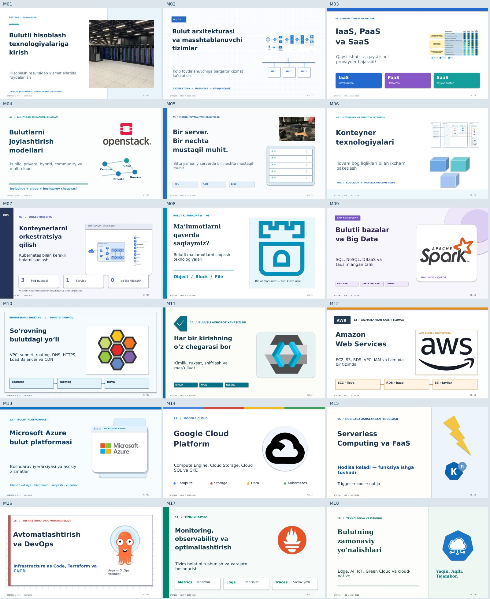

# Bulut texnologiyalari va servislar — BTST206

## Yangi fan: Loyihalarni boshqarish — LOBM404

**[Gitga kirish va Windowsga o‘rnatish — o‘zbekcha rasmli Word qo‘llanmalar](LOBM404_UniGuide/Dars_materiallari/Git_asoslari/)**

### L4 — WIP bo‘yicha rasmli amaliy loyiha

**[Bosqichma-bosqich qo‘llanma va 6 ta rasm](LOBM404_UniGuide/L4_amaliy_loyiha/)** · **[Word qo‘llanma](LOBM404_UniGuide/Dars_materiallari/L4_rasmli_amaliy_qollanma.docx)** · **[ZIP paket](LOBM404_UniGuide/Dars_materiallari/L4_amaliy_loyiha.zip)**

Brauzerda ochiladigan 6 bosqichli o‘quv mashqi, 9 karta, WIP limitlari, tiqilish tahlili va talabalar uchun shablonlar. Rasmlar o‘quv simulyatoriga tegishli; GitHub Projects doskasini yaratish tartibi qo‘llanmada berilgan.

**[15 laboratoriya uchun rasmli Word qo‘llanma — 86 sahifa](https://github.com/all1991here-dot/prezentatsiyalar/raw/refs/heads/main/LOBM404_UniGuide/Qollanma/LOBM404_15_laboratoriya_qollanma.docx)**

Bitta **UniGuide** loyihasi,15 talaba shabloni,15 to‘ldirilgan namuna, ishlaydigan Python ilovasi va testlar: **[LOBM404_UniGuide papkasi](LOBM404_UniGuide/)**.

**[Faqat LOBM404 loyiha materiallarini ZIP qilib olish](https://github.com/all1991here-dot/prezentatsiyalar/raw/refs/heads/main/LOBM404_Materiallar.zip)**

---

2027–2028 sillabusi asosida tayyorlangan 18 mavzu. **Har bir prezentatsiya alohida dizayn va uslubda qayta ishlangan. Ma’ruza nutqlari o‘zgartirilmagan.**

## Yuklab olish

- **[Barcha prezentatsiyalar va Word matnlarini ZIP formatida yuklab olish](https://github.com/all1991here-dot/prezentatsiyalar/raw/refs/heads/main/BTST206_Yangi_dizayn_18_mavzu.zip)**
- **[Barcha ma’ruza nutqlari — Word DOC](https://github.com/all1991here-dot/prezentatsiyalar/raw/refs/heads/main/Word/Barcha_18_mavzu_Maruza_nutqlari.doc)**
- **[Barcha ma’ruza nutqlari — Word DOCX](https://github.com/all1991here-dot/prezentatsiyalar/raw/refs/heads/main/Qoshimcha_DOCX/Barcha_18_mavzu_Maruza_nutqlari.docx)**

Agar fayl sahifasi ochilsa, **Download raw file** tugmasini bosing. Butun repozitoriyni yuklab olish uchun **Code → Download ZIP** ni tanlang.

## 18 xil dizayn

| Mavzu | Dizayn yo‘nalishi | Fayllar |
|---|---|---|
| M01. Bulutli hisoblash texnologiyalariga kirish | Akademik foto-jurnal | [PPTX](https://github.com/all1991here-dot/prezentatsiyalar/raw/refs/heads/main/PPTX/M01_Prezentatsiya.pptx) · [DOC](https://github.com/all1991here-dot/prezentatsiyalar/raw/refs/heads/main/Word/M01_Maruza_nutqi.doc) |
| M02. Bulut arxitekturasi va masshtablanuvchi tizimlar | Arxitektura va texnik qatlamlar | [PPTX](https://github.com/all1991here-dot/prezentatsiyalar/raw/refs/heads/main/PPTX/M02_Prezentatsiya.pptx) · [DOC](https://github.com/all1991here-dot/prezentatsiyalar/raw/refs/heads/main/Word/M02_Maruza_nutqi.doc) |
| M03. Bulut xizmat modellari: IaaS, PaaS va SaaS | Xizmatlar taqqoslash matritsasi | [PPTX](https://github.com/all1991here-dot/prezentatsiyalar/raw/refs/heads/main/PPTX/M03_Prezentatsiya.pptx) · [DOC](https://github.com/all1991here-dot/prezentatsiyalar/raw/refs/heads/main/Word/M03_Maruza_nutqi.doc) |
| M04. Bulutlarni joylashtirish modellari | Geografik tarmoq modeli | [PPTX](https://github.com/all1991here-dot/prezentatsiyalar/raw/refs/heads/main/PPTX/M04_Prezentatsiya.pptx) · [DOC](https://github.com/all1991here-dot/prezentatsiyalar/raw/refs/heads/main/Word/M04_Maruza_nutqi.doc) |
| M05. Virtualizatsiya texnologiyalari | Uskuna va texnik spetsifikatsiya | [PPTX](https://github.com/all1991here-dot/prezentatsiyalar/raw/refs/heads/main/PPTX/M05_Prezentatsiya.pptx) · [DOC](https://github.com/all1991here-dot/prezentatsiyalar/raw/refs/heads/main/Word/M05_Maruza_nutqi.doc) |
| M06. Konteyner texnologiyalari | Modulli konteyner bloklari | [PPTX](https://github.com/all1991here-dot/prezentatsiyalar/raw/refs/heads/main/PPTX/M06_Prezentatsiya.pptx) · [DOC](https://github.com/all1991here-dot/prezentatsiyalar/raw/refs/heads/main/Word/M06_Maruza_nutqi.doc) |
| M07. Konteynerlarni orkestratsiya qilish | Kubernetes klaster paneli | [PPTX](https://github.com/all1991here-dot/prezentatsiyalar/raw/refs/heads/main/PPTX/M07_Prezentatsiya.pptx) · [DOC](https://github.com/all1991here-dot/prezentatsiyalar/raw/refs/heads/main/Word/M07_Maruza_nutqi.doc) |
| M08. Bulutli ma’lumotlarni saqlash texnologiyalari | Saqlash katalogi | [PPTX](https://github.com/all1991here-dot/prezentatsiyalar/raw/refs/heads/main/PPTX/M08_Prezentatsiya.pptx) · [DOC](https://github.com/all1991here-dot/prezentatsiyalar/raw/refs/heads/main/Word/M08_Maruza_nutqi.doc) |
| M09. Bulutli ma’lumotlar bazalari va Big Data | Ma’lumotlar analitikasi | [PPTX](https://github.com/all1991here-dot/prezentatsiyalar/raw/refs/heads/main/PPTX/M09_Prezentatsiya.pptx) · [DOC](https://github.com/all1991here-dot/prezentatsiyalar/raw/refs/heads/main/Word/M09_Maruza_nutqi.doc) |
| M10. Bulutli tarmoq texnologiyalari | Tarmoq topologiyasi | [PPTX](https://github.com/all1991here-dot/prezentatsiyalar/raw/refs/heads/main/PPTX/M10_Prezentatsiya.pptx) · [DOC](https://github.com/all1991here-dot/prezentatsiyalar/raw/refs/heads/main/Word/M10_Maruza_nutqi.doc) |
| M11. Bulutli axborot xavfsizligi | Identifikatsiya va himoya | [PPTX](https://github.com/all1991here-dot/prezentatsiyalar/raw/refs/heads/main/PPTX/M11_Prezentatsiya.pptx) · [DOC](https://github.com/all1991here-dot/prezentatsiyalar/raw/refs/heads/main/Word/M11_Maruza_nutqi.doc) |
| M12. Amazon Web Services bulut platformasi | AWS arxitekturasi | [PPTX](https://github.com/all1991here-dot/prezentatsiyalar/raw/refs/heads/main/PPTX/M12_Prezentatsiya.pptx) · [DOC](https://github.com/all1991here-dot/prezentatsiyalar/raw/refs/heads/main/Word/M12_Maruza_nutqi.doc) |
| M13. Microsoft Azure bulut platformasi | Azure oynali kartalari | [PPTX](https://github.com/all1991here-dot/prezentatsiyalar/raw/refs/heads/main/PPTX/M13_Prezentatsiya.pptx) · [DOC](https://github.com/all1991here-dot/prezentatsiyalar/raw/refs/heads/main/Word/M13_Maruza_nutqi.doc) |
| M14. Google Cloud Platform bulut xizmatlari | Google Material va to‘rt rang | [PPTX](https://github.com/all1991here-dot/prezentatsiyalar/raw/refs/heads/main/PPTX/M14_Prezentatsiya.pptx) · [DOC](https://github.com/all1991here-dot/prezentatsiyalar/raw/refs/heads/main/Word/M14_Maruza_nutqi.doc) |
| M15. Serverless Computing va FaaS | Serverless hodisalar chizig‘i | [PPTX](https://github.com/all1991here-dot/prezentatsiyalar/raw/refs/heads/main/PPTX/M15_Prezentatsiya.pptx) · [DOC](https://github.com/all1991here-dot/prezentatsiyalar/raw/refs/heads/main/Word/M15_Maruza_nutqi.doc) |
| M16. Bulut infratuzilmasini avtomatlashtirish va DevOps | DevOps yetkazish konveyeri | [PPTX](https://github.com/all1991here-dot/prezentatsiyalar/raw/refs/heads/main/PPTX/M16_Prezentatsiya.pptx) · [DOC](https://github.com/all1991here-dot/prezentatsiyalar/raw/refs/heads/main/Word/M16_Maruza_nutqi.doc) |
| M17. Monitoring, observability va optimallashtirish | Monitoring boshqaruv paneli | [PPTX](https://github.com/all1991here-dot/prezentatsiyalar/raw/refs/heads/main/PPTX/M17_Prezentatsiya.pptx) · [DOC](https://github.com/all1991here-dot/prezentatsiyalar/raw/refs/heads/main/Word/M17_Maruza_nutqi.doc) |
| M18. Bulut texnologiyalarining zamonaviy yo‘nalishlari | Edge va kelajak texnologiyalari | [PPTX](https://github.com/all1991here-dot/prezentatsiyalar/raw/refs/heads/main/PPTX/M18_Prezentatsiya.pptx) · [DOC](https://github.com/all1991here-dot/prezentatsiyalar/raw/refs/heads/main/Word/M18_Maruza_nutqi.doc) |

## Tarkibi va foydalanish

- `PPTX/` — 18 ta tahrirlanadigan prezentatsiya; har birida 13 slayd, jami 234 slayd. Matn va texnik shakllar tahrirlanadi; internetdan olingan rasmlar joylashtirilgan tasvirlardir.
- `Word/` — alohida DOC nutqlar va barcha mavzular jamlangan 116 sahifalik Word hujjati.
- `Qoshimcha_DOCX/` — ayni nutqlarning zamonaviy Word nusxalari.
- `ASSET_SOURCES.md` — internet fotosuratlari, texnik rasmlar va rasmiy grafikalar manbalari hamda foydalanish izohlari.

PPTX taqdimotchi izohlari va barcha 38 ta Word fayli avvalgi nusxalar bilan aynan bir xil. O‘zgarishlar faqat prezentatsiyalar ko‘rinishi, internet rasmlari, rasm manbalari va yuklab olish tavsiflariga tegishli. Interaktiv topshiriqlar kiritilmagan.

Sillabusda har bir mavzu uchun 2 akademik soat berilgan. Nutqlar ixcham videoma’ruza uchun yozilgan; 90 daqiqalik uzluksiz nutq sifatida hisoblanmaydi. Xizmatlarning narxi, limiti va joriy nomlari amaldagi rasmiy hujjatlarda tekshiriladi.

Materiallar sillabus asosida mustaqil tayyorlangan; universitetning rasmiy tasdiqlash belgisi qo‘yilmagan.
